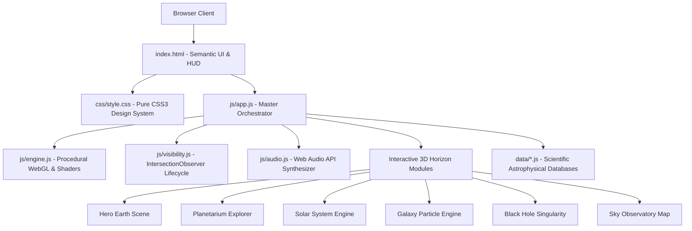

# 🌌 NOVA — Deep Space Exploration & Astronomical Observatory

> **"One planet. One civilization. An infinite universe."**
>
> An aerospace-grade, cinematic web application and digital planetarium exploring the cosmos—from low-Earth orbit to the farthest reaches of the observable universe. Built with WebGL (Three.js), procedural shader engines, interactive telemetry interfaces, and native ES6 modules with zero build-tool dependencies.

---

## 🧭 Table of Contents

- [🌌 Project Overview](#-project-overview)
- [✨ Key Features & Interactive Sections](#-key-features--interactive-sections)
  - [1. 🚀 Cinematic Intro & Hero Earth Approach](#1--cinematic-intro--hero-earth-approach)
  - [2. 📐 Powers of Ten: Scale of the Universe](#2--powers-of-ten-scale-of-the-universe)
  - [3. 🪐 "Choose Your World" 3D Planetarium Explorer](#3--choose-your-world-3d-planetarium-explorer)
  - [4. ☀️ 3D Solar System & Orbital Mechanics Simulation](#4-️-3d-solar-system--orbital-mechanics-simulation)
  - [5. 🌀 Galaxy Explorer & Morphological Particle Simulations](#5--galaxy-explorer--morphological-particle-simulations)
  - [6. 💫 Nebulae & The 6-Stage Stellar Genesis](#6--nebulae--the-6-stage-stellar-genesis)
  - [7. 🕳️ Relativistic Singularity & Black Hole Physics](#7-️-relativistic-singularity--black-hole-physics)
  - [8. 📊 Cosmological Data Hub & Cosmic Metrics](#8--cosmological-data-hub--cosmic-metrics)
  - [9. 🛰️ Human Exploration Missions Dossier](#9-️-human-exploration-missions-dossier)
  - [10. 🔭 Sky Observatory & Multi-Wavelength Star Map](#10--sky-observatory--multi-wavelength-star-map)
  - [11. ⏳ Chronicles of Discovery & The Speculative Next Chapter](#11--chronicles-of-discovery--the-speculative-next-chapter)
  - [12. 📚 The Astronomical Compendium & Research Archives](#12--the-astronomical-compendium--research-archives)
  - [13. 🌍 Narrative Return to Earth (The Pale Blue Dot)](#13--narrative-return-to-earth-the-pale-blue-dot)
  - [14. 🔍 Omnibox Global Search System](#14--omnibox-global-search-system)
  - [15. 🔊 Procedural Web Audio Synthesizer](#15--procedural-web-audio-synthesizer)
  - [16. 🎯 Custom Precision Reticle Cursor](#16--custom-precision-reticle-cursor)
  - [17. ⚡ Performance Architecture & Smart Touch Gestures](#17--performance-architecture--smart-touch-gestures)
  - [18. 🚀 Aerospace Rocket Hangar & Data Archives](#18--aerospace-rocket-hangar--data-archives)
- [🛠️ Architecture & Technology Stack](#️-architecture--technology-stack)
- [📁 Repository & Directory Structure](#-repository--directory-structure)
- [⌨️ Keyboard Shortcuts & Navigation Guide](#️-keyboard-shortcuts--navigation-guide)
- [💻 Quick Start & Running Locally](#-quick-start--running-locally)
- [🧪 Automated Test Suite](#-automated-test-suite)
- [Serverless Event Flow](#serverless-event-flow)
- [📜 Scientific References & Citations](#-scientific-references--citations)

---

## 🌌 Project Overview

**NOVA** is an immersive, scientifically grounded digital observatory and space exploration web application. Designed with the aesthetic discipline of an aerospace flight deck, it combines real astrophysical data with real-time WebGL rendering to deliver a fluid, educational journey through space and time.

### Core Design Principles
- **Astrophysical Precision**: Real planetary scales, astronomical coordinates (Right Ascension/Declination), orbital periods, spectral classifications, and relativistic formulas ($R_s = 2GM/c^2$, $E = mc^2$, Tsiolkovsky $\Delta v$).
- **Zero-Dependency Core**: 100% vanilla ES6 JavaScript modules with offline-capable Three.js and custom procedural canvas texture generators—no Node.js build pipelines, bundlers, or external frameworks required.
- **Cinematic Visuals**: Pure deep space void (`#02040A`), ACES Filmic tone mapping, multi-tier procedural starfields, volumetric atmospheric Fresnel shaders, and glowing telemetry HUDs.
- **Viewport-Aware Performance**: Granular `IntersectionObserver` lifecycle management that selectively suspends WebGL draw calls when sections are offscreen, preserving a fluid 60–120 FPS on all devices.

---

## ✨ Key Features & Interactive Sections

### 1. 🚀 Cinematic Intro & Hero Earth Approach
- **Genesis Sequence** (`js/intro.js`): Starts in pitch black, ignites a solitary genesis star, tracks deep-space telemetry initialization progress ($0\% \rightarrow 100\%$), and smoothly transitions into Earth's orbital approach.
- **Full-Bleed 3D Earth** (`js/hero.js`):
  - Procedurally generated high-resolution Earth textures with deep abyssal oceans, continental shelves, and vegetation masks.
  - Dual-layer atmospheric glow: inner Rayleigh scattering shader and outer volumetric exosphere rim.
  - High-contrast directional solar grazing light with specular ocean reflection.
  - 4-tier deep-space starfield depth with subtle mouse parallax and inertia-based dragging.
- **Spacecraft Telemetry HUD**: Live corner crosshairs displaying real-time coordinates, orbital altitude ($420.5\text{ km}$ LEO), orbital velocity ($29.78\text{ km/s}$), axial tilt ($23.44^\circ$), and spectral sensor status.

### 2. 📐 Powers of Ten: Scale of the Universe
- **Continuous Cosmological Zoom** (`js/scale-explorer.js`, `data/scale.js`):
  - Explores spatial magnitude across 8 logarithmic powers of ten:
    1. **$10^0\text{ m}$ (The Observer)**: Human height and immediate biological scale.
    2. **$10^7\text{ m}$ (Planet Earth)**: $12,742\text{ km}$ terrestrial cradle.
    3. **$10^{11}\text{ m}$ (Astronomical Unit)**: $149.6\text{M km}$ Earth-Sun baseline.
    4. **$10^{13}\text{ m}$ (Heliospheric Boundary)**: $\sim 100\text{ AU}$ Solar System and Kuiper Belt frontier.
    5. **$10^{16}\text{ m}$ (Interstellar Neighborhood)**: $4.246\text{ ly}$ to Proxima Centauri.
    6. **$10^{21}\text{ m}$ (Galactic Horizon)**: $\sim 100,000\text{ ly}$ across the Milky Way disc.
    7. **$10^{23}\text{ m}$ (Extragalactic Cluster)**: $\sim 10\text{M ly}$ Local Group and Virgo Supercluster.
    8. **$10^{26}\text{ m}$ (The Observable Universe)**: $93\text{ Billion light-years}$ cosmic light horizon.
  - Interactive logarithmic slider, step ticks, comparative unit breakdowns, and contextual descriptions.

### 3. 🪐 "Choose Your World" 3D Planetarium Explorer
- **Interactive Planetary Suite** (`js/planet-explorer.js`, `data/planets.js`):
  - High-detail 3D models for all 8 major Solar System planets: **Mercury**, **Venus**, **Earth**, **Mars**, **Jupiter**, **Saturn** (with procedural concentric rings and shadow casting), **Uranus**, and **Neptune**, plus the **Sun**.
  - **Procedural Canvas Textures** (`js/engine.js`): Real-time procedural surface maps for each celestial body, including Jupiter's Great Red Spot bands, Martian iron-oxide topography, and Venusian sulfuric acid cloud layers.
  - **Atmosphere Shader Toggle**: Dynamically activate or deactivate atmospheric rim glow shaders.
  - **Live Scientific Specs**: Distance from Sun (in AU and km), equatorial diameter, day and year duration, surface gravity ($G$), natural satellites (moons), interactive atmospheric density bar, and key geological/atmospheric landmarks.

### 4. ☀️ 3D Solar System & Orbital Mechanics Simulation
- **Gravitational Choreography** (`js/solarsystem.js`):
  - Luminous central star with multi-layer corona and 8 planetary bodies revolving along individual orbital inclinations and velocities.
  - **Dual Scale Modes**:
    - **Visual Scale Mode**: Stylized planetary sizes and orbital radii for clear, comfortable visual inspection.
    - **Physical Scale Mode**: Accurate astronomical proportions ($0.39\text{ AU}$ to $30.07\text{ AU}$) with smooth camera transition and wide frustum.
  - **Simulation Speed Control**: Accelerate or pause time ($0.5\times$, $1.0\times$, $2.0\times$, $5.0\times$, and `PAUSE`).
  - **Spherical Camera Navigation**: Left-click drag to orbit $360^\circ$, scroll wheel to zoom, and one-click camera reset.

### 5. 🌀 Galaxy Explorer & Morphological Particle Simulations
- **Astrophysical Particle Engines** (`js/galaxy-explorer.js`, `data/galaxies.js`):
  - **Spiral Galaxies (Milky Way & Andromeda)**: Luminous central galactic bulge, stellar bar, and logarithmic spiral arms populated by star-forming H II clusters and interstellar dust lanes.
  - **Giant Elliptical Galaxies (Messier 87 / Virgo A)**: 3D ellipsoidal stellar swarm hosting over 12,000 globular clusters and a relativistic plasma jet blasting $5,000\text{ ly}$ into intergalactic space.
  - **Irregular Galaxies (Large Magellanic Cloud)**: Asymmetric, turbulent particle distribution depicting gravitational tidal disruption and violent starburst nurseries (Tarantula Nebula).
  - Detailed astrophysical dossiers with rotation periods, central supermassive black hole masses (Sagittarius A\*, M87\*), and star counts.

### 6. 💫 Nebulae & The 6-Stage Stellar Genesis
- **Interactive Star Formation Stepper** (`js/nebula-section.js`):
  - Volumetric procedural gas cloud canvas rendered with multi-octave turbulence.
  - Step-by-step narrative walkthrough through stellar evolution:
    1. **Giant Molecular Cloud**: $10\text{--}20\text{ K}$, $100\text{ ly}$ cold hydrogen reservoirs.
    2. **Gravitational Collapse**: Shockwave-triggered fragmentation and proto-planetary disk formation.
    3. **Protostar Emergence**: Gravitational heating ($2,000\text{--}3,000\text{ K}$) and bipolar magnetic plasma jets.
    4. **Core Temperature Surge**: Crushing compression reaching $1\text{--}5\text{ Million K}$.
    5. **Nuclear Fusion Ignition**: Core breaches $15\text{ Million K}$; proton-proton chain converts hydrogen into helium ($E = mc^2$).
    6. **Main Sequence Equilibrium**: Outward thermal radiation pressure balances inward gravitational collapse (Hydrostatic Equilibrium).

### 7. 🕳️ Relativistic Singularity & Black Hole Physics
- **Gargantua Relativistic Simulation** (`js/blackhole.js`):
  - 3D Kerr black hole visualizer featuring:
    - **Event Horizon ($R_s = 2GM/c^2$)**: The boundary beyond which escape velocity exceeds the speed of light.
    - **Photon Sphere ($1.5 R_s$)**: Relativistic photon orbits creating a radiant optical ring.
    - **Keplerian Accretion Disk**: Plasma heated to millions of Kelvin with Doppler beaming/boosting.
    - **Gravitational Lensing**: Curved spacetime bending light from behind the singularity into twin symmetrical lensing arcs.
  - Individual toggle switches to isolate the Horizon, Accretion Disk, or Gravitational Lensing effect.

### 8. 📊 Cosmological Data Hub & Cosmic Metrics
- **Animated Cosmological Counters** (`js/datahub.js`):
  - Activated via viewport intersection with cubic easing:
    - **$13.787\text{ Billion Years}$**: Precise age of the universe since the Big Bang.
    - **$93.0\text{ Billion Light-Years}$**: Comoving diameter of the observable universe.
    - **$2 \times 10^{22}$**: Estimated stars across the cosmos.
    - **$2.725\text{ K}$**: Cosmic Microwave Background radiation temperature.

### 9. 🛰️ Human Exploration Missions Dossier
- **Mission Archives & Telemetry Drawer** (`js/missions.js`, `data/missions.js`):
  - Interactive grid with category filters: **All**, **Lunar**, **Mars**, **Deep Space**, and **Telescopes**.
  - Detailed modal dossiers for landmark missions:
    - **Apollo 11** (1969): First human lunar landing in Mare Tranquillitatis.
    - **Voyager 1** (1977): Interstellar grand tour probe, now $> 163\text{ AU}$ away.
    - **Hubble Space Telescope** (1990): 34+ years of optical and UV discoveries in LEO.
    - **James Webb Space Telescope** (2021): Infrared flagship at Sun-Earth L2.
    - **Cassini-Huygens** (1997): Titan landing and Enceladus ice plume discoveries.
    - **Perseverance & Ingenuity** (2020): Mars regolith core sampling and 72 atmospheric helicopter flights.
    - **Artemis Program** (2026+): Return of human crews to the Lunar South Pole.
  - Displays crew manifest, launch vehicles, mission duration, distances traveled, primary flight goals, and scientific legacies.

### 10. 🔭 Sky Observatory & Multi-Wavelength Star Map
- **Interactive Astronomical Sky Dome** (`js/observatory.js`, `data/stars.js`):
  - High-precision 2D celestial sphere projection rendering authenticated stars and constellations.
  - **Multi-Wavelength Spectrum Switcher**:
    - **Visible Light**: True astronomical magnitudes and spectral colors.
    - **Infrared (JWST)**: Pierces interstellar dust to reveal circumstellar debris disks.
    - **X-Ray (Chandra)**: Highlights high-energy coronal emissions, colliding winds, and white dwarf companions.
    - **Radio (ALMA)**: Resolves non-thermal molecular outflows and synchrotron emission.
  - **Constellation Overlays**: Interactive toggle connecting asterism lines (Canis Major, Orion, Lyra, Ursa Major, Scorpius, Taurus, Cassiopeia, Cygnus).
  - **Stellar Telemetry Inspector**: Click or hover any major star (**Sirius**, **Betelgeuse**, **Rigel**, **Vega**, etc.) to view spectral class, apparent magnitude, Right Ascension, Declination, surface temperature, and distance in light-years.

### 11. ⏳ Chronicles of Discovery & The Speculative Next Chapter
- **Chronological Milestones** (`js/timeline-section.js`, `data/timeline.js`):
  - Traverses four centuries of astronomical history:
    - **1609**: Galileo turns the optical telescope toward Jupiter and Venus.
    - **1957**: Sputnik 1 ignites the Space Age.
    - **1961**: Yuri Gagarin becomes the first human in space aboard Vostok 1.
    - **1969**: Neil Armstrong and Buzz Aldrin set foot on the Moon.
    - **1977**: Voyager 1 & 2 launch on the Interstellar Grand Tour.
    - **1990**: Hubble Space Telescope deployed into LEO.
    - **1998**: International Space Station assembly begins with Zarya.
    - **2021**: James Webb Space Telescope launches and unfolds at L2.
    - **2026+**: Artemis program returns humans to deep space.
  - **Speculative Horizons**: Architectural projections for Lunar Gateway, Crewed Martian Outposts, Breakthrough Starshot relativistic interstellar nanocrafts, and Dyson Swarms.

### 12. 📚 The Astronomical Compendium & Research Archives
- **Curated Knowledge Base** (`js/resources.js`, `data/resources.js`):
  - **Observatories & Web Tools**: Direct portals to NASA Eyes on the Solar System, JWST Gallery, Stellarium Web, European Southern Observatory (ESO), Astronomy Picture of the Day (APOD), and NASA ADS Harvard Smithsonian library.
  - **Seminal Literature**: Reading guides for foundational astrophysics works (*Cosmos* and *Pale Blue Dot* by Carl Sagan, *A Brief History of Time* by Stephen Hawking, *Astrophysics for People in a Hurry* by Neil deGrasse Tyson, and *The Science of Interstellar* by Kip Thorne).

### 13. 🌍 Narrative Return to Earth (The Pale Blue Dot)
- **Philosophical Closure** (`js/narrative-return.js`):
  - A quiet, solitary 3D Earth suspended in the cosmic expanse, accompanied by Carl Sagan’s timeless reflection reminding us that all of human history and triumph has taken place on "a mote of dust suspended in a sunbeam."

### 14. 🔍 Omnibox Global Search System
- **Cosmic Search Omnibox** (`js/search.js`):
  - Activated via header HUD button, keybinding (`Ctrl+K`, `Cmd+K`, or `/`).
  - Indexes all planets, galaxies, space missions, stars, scale steps, and archives with real-time keyword matching and auto-scroll navigation.

### 15. 🔊 Procedural Web Audio Synthesizer
- **Native Web Audio API Engine** (`js/audio.js`):
  - 100% synthesized in-browser with zero external audio assets or bandwidth overhead.
  - Sub-bass cosmic ambient hum ($48\text{ Hz}$ sawtooth wave with a $140\text{ Hz}$ resonant lowpass filter).
  - Telemetry confirmation beeps and UI frequency sweeps.
  - Persistent HUD mute/unmute toggle button.

### 16. 🎯 Custom Precision Reticle Cursor
- **Aerospace Reticle System** (`js/cursor.js`):
  - High-precision center targeting dot paired with a smooth-lerping outer crosshair ring.
  - Reactive expansion on hoverable elements and animated concentric click-ripples.
  - Automatically disabled on touch and mobile devices to preserve native usability.

### 17. ⚡ Performance Architecture & Smart Touch Gestures
- **Viewport Visibility Manager** (`js/visibility.js`):
  - `IntersectionObserver` with $250\text{px}$ pre-warm margin: suspends WebGL render loops when canvases are outside the viewport, conserving GPU memory and battery life.
  - Detects tab visibility (`document.hidden`) to pause CPU/GPU cycles when switching tabs.
  - Dynamic DPR calculation: clamped to $1.5\times$ on mobile and $2.0\times$ on desktop to avoid thermal throttling.
  - **Smart Touch Gestures**: Differentiates between vertical gestures (allowing smooth native page scrolling) and horizontal/diagonal gestures (capturing 3D camera rotation).

### 18. 🛰️ Space Agency Channels & Community Telemetry
- **Official Space Agency Channels & General Space**:
  - Direct integration with 8 verified space agencies (NASA, ESA, ISRO, JAXA, CNSA, Roscosmos, CSA, UAESA) and the open celestial channel **General Space**.
  - Real-time launch manifests cached via external telemetry and live countdown clocks.
  - Research outreach proposal submission with copy-ready institutional inquiry drafts.
  - Multi-tier engagement feed with chronological (`sort=new`), trending engagement (`sort=hot`), and top-rated horizons (`sort=top`).

---

## 🛠️ Architecture & Technology Stack



| Layer | Technologies & Standards | Description |
| :--- | :--- | :--- |
| **Markup & Semantics** | HTML5, JSON-LD Structured Data, OpenGraph | Semantic, accessible document structure with rich metadata for SEO. |
| **Styling & HUD** | Vanilla CSS3, CSS Custom Properties, Flexbox, Grid | Spacecraft visor aesthetic, glassmorphic panels, and responsive media queries. |
| **3D Graphics** | WebGL, Three.js (r128), Custom GLSL Shaders | Custom Fresnel atmosphere shaders, ACES Filmic tone mapping, procedural noise texturing. |
| **Typography** | Google Fonts (`Space Grotesk`, `Inter`, `JetBrains Mono`) | Clean, technical, high-legibility typographic hierarchy. |
| **Audio** | Native Web Audio API | Zero-asset, algorithmic sound synthesis (drone + telemetry bleeps). |
| **Server & Test** | Python 3, Flask, Gunicorn, SQLite WAL, Pillow, Boto3 | Production WSGI backend with security headers, CSRF protection, and automated verification. |

---

## 📁 Repository & Directory Structure

```plaintext
website/
├── index.html               # Main application entry point & semantic HUD layout
├── social.html              # NOVA Social dispatch feed & agency tracking hub
├── profile.html             # Observer profile with customizable banner & avatar
├── agency_detail.html       # Agency channel dossier & official feed view
├── agencies.html            # Agency directory & global search
├── auth.html                # Observer authentication & access recovery
├── moderation.html          # Curator moderation & content integrity console
├── submit.html              # Standalone observation dispatch composer
├── terms.html               # Terms of Service document
├── privacy.html             # Privacy Policy document
├── contact.html             # Spacecraft telemetry & mission control contact
├── 403.html / 404 / 500     # Themed HTTP error recovery pages
├── README.md                # Comprehensive project documentation
├── server.py                # Production Flask application & API backend
├── manage.py                # Administrative CLI (migrate, seed, curator creation)
├── gunicorn.conf.py         # Production WSGI application server configuration
├── requirements.txt         # Pinned Python package dependencies
├── .env.example             # Documented production environment template
├── .gitignore               # Strict exclusion of secrets, databases, logs, uploads
│
├── css/
│   ├── style.css            # Unified design system, HUD tokens, animations & responsive layout
│   ├── avatar.css           # Avatar monograms, status indicators & canvas crop modal
│   ├── postcard.css         # Observation dispatch card components
│   ├── social.css           # NOVA Social layout & sidebar styles
│   └── ui.css               # Shared HUD UI components (modals, toasts, buttons)
│
├── data/
│   ├── galaxies.js          # Morphological galaxy parameters (Spiral, Elliptical, Irregular)
│   ├── missions.js          # Human spaceflight and robotic missions dossier
│   ├── planets.js           # Scientific database for 8 planets + Sun
│   ├── resources.js         # Curated observatories, research libraries & literature archives
│   ├── scale.js             # Powers of Ten scale progression database (1m to 93B ly)
│   ├── stars.js             # Astronomical star catalog (RA, Dec, spectral classes, constellations)
│   └── timeline.js          # Chronological exploration milestones & speculative future chapters
│
├── js/
│   ├── app.js               # Master orchestrator bootstrapping cosmic scenes & navigation
│   ├── api.js               # Client API transport with automatic CSRF token injection
│   ├── audio.js             # Synthesized procedural Web Audio ambience & telemetry feedback
│   ├── avatar.js            # Unified avatar & agency logo component renderer
│   ├── blackhole.js         # Kerr black hole simulation with accretion disk & gravitational lensing
│   ├── composer.js          # Observation dispatch composer modal (Text, Media, Link tabs)
│   ├── cursor.js            # Precision spacecraft HUD reticle cursor with click ripples
│   ├── datahub.js           # Cosmological counters triggered via viewport intersection
│   ├── engine.js            # Procedural texture generator & GLSL atmospheric Fresnel shaders
│   ├── feed-state.js        # Reactive state manager for social feed & comments
│   ├── galaxy-explorer.js   # 3D galactic particle simulations with morphological models
│   ├── gallery.js           # Sky Gallery interface with full-screen lightbox modal
│   ├── hero.js              # Full-bleed 3D Earth approach with dual atmospheric scattering
│   ├── image-modal.js       # Client-side HTML5 canvas image crop & zoom modal
│   ├── intro.js             # Cinematic genesis star & telemetry loading sequence
│   ├── missions.js          # Mission dossier filtering and technical specs modal drawer
│   ├── narrative-return.js  # Pale Blue Dot reflection scene & concluding Earth perspective
│   ├── nebula-section.js    # 6-stage stellar evolutionary genesis & volumetric cloud canvas
│   ├── observatory.js       # Interactive sky observatory & multi-wavelength star map
│   ├── page-404.js          # Themed error page interactive star background
│   ├── page-agencies.js     # Space agencies directory page logic
│   ├── page-agency-detail.js# Space agency detail view with cached news & dispatches
│   ├── page-auth.js         # Authentication, login, register, password reset flows
│   ├── page-moderation.js   # Curator moderation queue & dispatch review
│   ├── page-profile.js      # Observer profile page & privacy settings
│   ├── page-social.js       # Feed view, dispatch interaction & masonry layout
│   ├── planet-explorer.js   # "Choose Your World" 3D planetarium inspector & telemetry
│   ├── postcard.js          # Modular PostCard rendering for dispatches
│   ├── resources.js         # Astronomical compendium directory and literature filters
│   ├── scale-explorer.js    # Powers of Ten interactive logarithmic scale controller
│   ├── search.js            # Global omnibox search modal (Ctrl+K / Cmd+K)
│   ├── social.js            # Shared social state & topbar auth controls
│   ├── solarsystem.js       # 3D Solar System simulation (Visual vs Physical AU scale modes)
│   ├── timeline-section.js  # Interactive historical timeline track & future concepts
│   ├── ui.js                # Shared UI utilities (toasts, modals, confirmations)
│   ├── visibility.js        # IntersectionObserver lifecycle, DPR optimizer & touch handling
│   └── vendor/
│       ├── three.min.js     # Three.js (r128) WebGL 3D rendering library
│       └── OrbitControls.js # Spherical orbital camera navigation controller
│
├── migrations/              # Numbered, idempotent database schema migrations (001 to 006)
├── deploy/                  # Production AWS deployment assets & scripts
├── report/                  # Architecture report, test matrix, and screenshots checklist
└── scripts/
    └── housekeeping.py      # Automated maintenance routine (token purge, cache cleanup)
```

---

## ⌨️ Keyboard Shortcuts & Navigation Guide

| Shortcut / Action | Function | Scope |
| :--- | :--- | :--- |
| <kbd>⌘K</kbd> or <kbd>Ctrl+K</kbd> | Open the **Cosmic Omnibox Search** modal | Global |
| <kbd>/</kbd> | Open Search modal (when no input is focused) | Global |
| <kbd>Esc</kbd> | Close any open modal (Search, Mission Dossier, Mobile Menu) | Global |
| **Left Click + Drag** | Rotate 3D camera / orbit around celestial bodies | 3D Viewports |
| **Scroll Wheel / Pinch** | Zoom in / out smoothly | 3D Viewports |
| **Audio HUD Button** | Toggle procedural deep-space synthesizer ON / OFF | Global |
| **Mode Toggle Button** | Switch between Experience Mode and Data Telemetry Mode | Navbar |
| **Skip Intro Button** | Fast-forward cinematic genesis loading sequence | Intro Screen |

---

## 💻 Quick Start & Running Locally

NOVA is completely self-contained and comes with a unified management CLI.

### 1. Initialize Database Schema & Seed Official Channels
```bash
# Run idempotent database schema migrations
python3 manage.py migrate

# Seed official space agency channels (NASA, ESA, ISRO, JAXA, CNSA, Roscosmos, CSA, UAESA) + General Space
python3 manage.py seed
```

### 2. Create the Initial Curator / Admin Account
```bash
# Prompts securely for nickname, email, and password (Bcrypt hashed)
python3 manage.py create-curator
```

### 3. Launch the Application Server
```bash
# Launch development server (default: http://localhost:8080)
python3 manage.py runserver

# Or with server.py directly:
python3 server.py --port 8080
```

---

## 🧪 Automated Test Suite

NOVA includes a comprehensive 46-test automated integration harness verifying CSRF protection, password policies, brute-force lockouts, S3 storage mode, Pillow metadata sanitization, and security headers:

```bash
# Run test suite via manage.py
python3 manage.py test

# Or via server.py directly
python3 server.py --test
```

**Expected output:**
```text
Test Successful: http://127.0.0.1:8000/index.html returned HTTP 200
Data API Test: http://127.0.0.1:8000/data/planets.js returned HTTP 200
Data API Test: http://127.0.0.1:8000/data/scale.js returned HTTP 200
Data API Test: http://127.0.0.1:8000/data/galaxies.js returned HTTP 200
Data API Test: http://127.0.0.1:8000/data/missions.js returned HTTP 200
Data API Test: http://127.0.0.1:8000/data/stars.js returned HTTP 200
Data API Test: http://127.0.0.1:8000/data/timeline.js returned HTTP 200
Data API Test: http://127.0.0.1:8000/data/resources.js returned HTTP 200
All server tests passed!
```

## Serverless Event Flow

NOVA's S3 observation-manifest processor, offline tests, and AWS integration guide are in [`serverless/`](serverless/).

---

## 📜 Scientific References & Citations

The astronomical data, orbital trajectories, and physical constants implemented across NOVA are sourced from verified scientific repositories and public mission archives:

1. **NASA Jet Propulsion Laboratory (JPL)** — *HORIZONS Ephemeris System & Planetary Fact Sheets*.
2. **Space Telescope Science Institute (STScI)** — *James Webb Space Telescope & Hubble Space Telescope Public Archives*.
3. **European Southern Observatory (ESO)** — *Very Large Telescope (VLT) & ALMA Interferometry Surveys*.
4. **European Space Agency (ESA)** — *Gaia Space Observatory DR3 Star Catalog*.
5. **Event Horizon Telescope (EHT) Collaboration** — *Relativistic imaging of M87\* and Sagittarius A\**.
6. **Carl Sagan** — *Cosmos* (1980) & *Pale Blue Dot: A Vision of the Human Future in Space* (1994).
7. **Kip S. Thorne** — *The Science of Interstellar* (2014) & Gravitational Lensing Computations.

---

<p align="center">
  <b>Designed for Exploration • Engineered for Scientific Precision</b><br />
  <sub>NOVA Deep Space Observatory • Explore the Unknown</sub>
</p>
