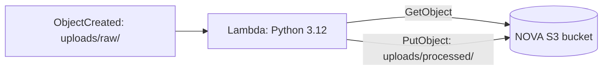

# NOVA Serverless Event Flow

This directory contains an S3-triggered AWS Lambda processor for NOVA observation manifests. Objects under `uploads/raw/` must contain a UTF-8 JSON object with non-empty `observation_id`, `agency_or_channel`, `timestamp`, and `media_key` string fields. Valid objects are enriched and written under `uploads/processed/`.

## Architecture



The Lambda reads the triggering object from the same bucket, validates its JSON envelope, adds a UTC `processed_at` timestamp and source bucket/key metadata (plus available ETag/version ID), then writes JSON with `Content-Type: application/json`. The output key preserves the path below `uploads/raw/`; a non-JSON input name receives a `.json` suffix. For example, `uploads/raw/2026/obs-42.json` becomes `uploads/processed/2026/obs-42.json`.

## Runtime and Reliability

- **Cold starts:** `boto3.client("s3")` and environment configuration are initialized once at module import and reused by warm invocations. Python 3.12 and the standard-library JSON/date helpers keep the handler lightweight; `boto3` is supplied by the Lambda Python runtime, so no third-party deployment package is needed.
- **Timeouts:** Set a Lambda timeout appropriate for the maximum expected object size and S3 latency (for example, 30 seconds for small metadata manifests). `TIMEOUT_BUFFER_SEC` defaults to 5; before each record, the handler checks `context.get_remaining_time_in_millis()` and defers the current and remaining records when the buffer is reached. The configured buffer should leave enough time for the invocation to return normally.
- **Batch outcomes:** Each record gets an independent result. Invalid JSON, missing fields, malformed events, and S3 errors are reported in `results` without aborting later records. The top-level `statusCode` is `200` for success/skips, `207` when one or more records failed, or `202` when records were deferred.
- **Loop prevention:** Any key under the configured `OUTPUT_PREFIX` is skipped. Keep this prefix outside the S3 notification's `uploads/raw/` filter.

## AWS Integration Decisions

- **One bucket, separated prefixes:** Raw inputs and processed manifests share the NOVA bucket and use distinct prefixes. This avoids an extra bucket and keeps the flow aligned with NOVA's existing storage policy. The notification must be added by the stack or deployment process that owns the existing bucket; preserve its other notification rules when updating bucket notifications.
- **Least privilege:** Grant the Lambda role `s3:GetObject` only on `arn:aws:s3:::<bucket>/uploads/raw/*` and `s3:PutObject` only on `arn:aws:s3:::<bucket>/uploads/processed/*`, plus the standard CloudWatch Logs actions. Configure an S3 `ObjectCreated` notification with prefix `uploads/raw/` and invoke permission for this Lambda. Do not grant bucket-wide object access.
- **Idempotency:** The destination key is deterministic from the input key, so retrying the same S3 event overwrites the same manifest instead of creating duplicates. `processed_at` will reflect the latest attempt; use S3 versioning or a conditional write if immutable attempt history is required. S3 notifications are at-least-once, so consumers should also tolerate duplicate events.
- **Deterministic tests:** Unit tests replace the module-level S3 client with mocks. They require no AWS credentials, network access, or deployed resources.
- **Metadata summary:** The enriched manifest is the source of truth. A separate DynamoDB or S3 summary can be added later if indexed lookup or aggregate reporting becomes necessary.

The processor uses one Lambda invocation per S3 notification and returns structured record outcomes. If deferred or failed records must be durably replayed, route notifications through SQS with a dead-letter queue and configure Lambda partial-batch failure handling; direct S3 notifications do not consume the handler's returned status object as a per-record retry contract.

## Local Tests

From the repository root, create and activate a virtual environment, install the test dependencies, and run the offline suite:

```bash
cd serverless
python3 -m venv .venv
source .venv/bin/activate
python -m pip install --upgrade pip
python -m pip install pytest boto3
pytest -v
```

The deployment handler is `src/handler.py` and its entry point is `handler.lambda_handler`.